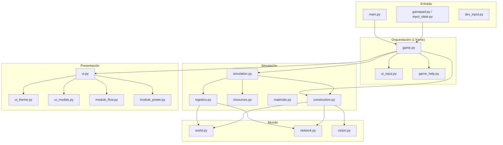

# Arquitectura de Solitudine

> Referencia para entender el código, tomar decisiones coherentes y saber **dónde** añadir funcionalidad nueva.
> Complementa [diseno-juego.md](diseno-juego.md) (qué debe hacer el juego) con **cómo** está organizado el código.

---

## Principios

| Principio | En la práctica |
|-----------|----------------|
| **KISS** | Sin frameworks ni capas innecesarias. Un `.py` = una responsabilidad clara. |
| **DRY** | Una sola fuente de verdad: constantes en `config.py`, textos en `locales/`, modales en `ui_modals.py`, colores en `ui_theme.py`. |
| **Single Responsibility** | La simulación no dibuja; la UI no muta el mundo; `game.py` solo orquesta. |

---

## Vista general



---

## Flujo de un frame (`game.py`)

Orden fijo cada iteración:

1. **Eventos** → `Input.poll()` (mando o teclado dev).
2. **Política de input** → `ui_input.input_policy()` (¿pausa tiempo? ¿bloquear cursor?).
3. **Acciones del jugador** → pausa, construcción, inspección, colocación.
4. **Simulación** → `Simulation.update(dt, world)` si no está pausado.
5. **Cámara y cursor** según política.
6. **Dibujado** → mapa, HUD, panel, modales encima.
7. **Ayuda contextual** → `game_help.context_help()`.

`game.py` **no** debe acumular lógica de negocio: solo enlaza subsistemas.

---

## Flujo de simulación (`simulation.py`)

Por tick (cuando no hay pausa ni game over):

1. Avanzar reloj (`day`, `day_progress`).
2. **`apply_modules_dt()`** — producción, energía proporcional, buffers (`logistics.py`).
3. **`consume_astronaut_dt()`** — O₂, agua, comida del astronauta (`resources.py`).
4. **`build.update_sites()`** — progreso de construcción (`construction.py`).
5. **`check_death()`** — game over si O₂/agua/comida = 0.

**Orden importante:** producir → consumir → morir. Cambiar este orden altera el balance.

---

## Capas y archivos

### Configuración e i18n

| Archivo | Responsabilidad |
|---------|-----------------|
| `config.py` | Constantes numéricas: caps, costes, tiempos, tamaño mapa. **Editar aquí** al balancear. |
| `locales/es.json` | Cadenas visibles al jugador. Claves usadas con `t("clave")` vía `i18n.py`. |
| `i18n.py` | Carga JSON de idioma. |

### Entrada

| Archivo | Responsabilidad |
|---------|-----------------|
| `gamepad.py` | Nombres semánticos de botones (`A`, `LJOY_UP`, …). |
| `input_state.py` | Estado del mando por frame (`held`, `pressed`). |
| `dev_input.py` | Teclado → mando en PC (`SOLITUDINE_DEV=1`). |
| `ui_input.py` | **Política** de qué input está permitido según modo (pausa, menú construcción, game over). |

### Mundo y mapa

| Archivo | Responsabilidad |
|---------|-----------------|
| `world.py` | Grid 1024², tiles, depósitos, módulos, generación procedural. |
| `network.py` | Red logística (BFS desde hábitat por cables). |
| `vision.py` | Niebla/explorado/visión clara (contadores incrementales). |
| `camera.py` | Pan, zoom, conversión tile ↔ pantalla. |

### Economía y supervivencia

| Archivo | Responsabilidad |
|---------|-----------------|
| `resources.py` | Reservas del hábitat (O₂, E, agua, comida) y consumo del astronauta. |
| `materials.py` | Componentes y mineral (stock de construcción). |
| `logistics.py` | **Único lugar** para producción/consumo por tick de módulos, buffers y reparto de energía. |
| `simulation.py` | Reloj, estado global (`game_over`, pausa), encadena los sistemas anteriores. |

### Construcción

| Archivo | Responsabilidad |
|---------|-----------------|
| `construction.py` | Máquina de estados: `NONE` → `MENU` → `PLACE`. Validación, costes, cables, sitios en obra. |

### UI (presentación)

| Archivo | Responsabilidad |
|---------|-----------------|
| `ui_theme.py` | Colores, rects de layout (`map_rect`, `panel_rect`), `format_amount`, `alert_color`. |
| `ui_modals.py` | **`draw_map_modal()`** — recuadro centrado en el mapa (pausa, menú construcción, game over). |
| `ui.py` | Dibujado: mapa, barras, panel de inspección, colocación. Compone theme + modals. |
| `module_flow.py` | Flujos diarios mostrados en panel (+O₂, −agua, …). Debe coincidir con `logistics.py`. |
| `module_power.py` | Balance E/día por módulo en panel. Debe coincidir con demanda en `logistics.py`. |
| `game_help.py` | Texto de la barra inferior según contexto. |

---

## UI: modales vs panel

| Situación | Dónde se muestra | Oscurece mapa |
|-----------|------------------|---------------|
| Elegir pieza (`BuildMode.MENU`) | Modal (`draw_build_menu_modal`) | Sí |
| Pausa (`user_paused`) | Modal (`draw_pause_modal`) | No |
| Game over | Modal (`draw_game_over`) | Sí |
| Colocar pieza (`BuildMode.PLACE`) | **Panel lateral** (coste, tiempo, validez) | No |

Todos los modales usan **`draw_map_modal()`** en `ui_modals.py`. Para un modal nuevo: construir `list[ModalLine]` y llamar a esa función.

---

## Guía: añadir funcionalidad

### Nuevo módulo constructible

1. **`config.py`** — coste, tiempo build, producción/consumo diario, buffer si aplica.
2. **`construction.py`** — `BuildKind`, `BUILD_KINDS`, `module_kind_for`, validación de tile si hace falta.
3. **`world.py`** — solo si necesita campos nuevos en `Module`.
4. **`logistics.py`** — lógica de producción en `apply_modules_dt()` (único lugar).
5. **`module_flow.py`** y **`module_power.py`** — líneas del panel (reflejar logistics).
6. **`locales/es.json`** — `build.*`, `module.*`, `flow.*` si aplica.
7. **`ui.py`** — color en `ui_theme.MODULE_COLORS`, dibujo si el módulo es especial.

### Nuevo recurso en la red

1. **`config.py`** — cap base, tasa, inicio.
2. **`resources.py`** o **`materials.py`** — pool y consumo.
3. **`logistics.py`** — caps en `_NetworkCaps`, producción y flush de buffers.
4. Panel hábitat en **`ui.py`** (`_draw_habitat_resources`) y strings en locales.

### Nueva pantalla o modal

1. Definir líneas → **`ui_modals.draw_map_modal()`** (no duplicar cajas).
2. Llamar desde **`game.py`** después del dibujado base, mismo patrón que pausa/game over.
3. Si bloquea input: extender **`ui_input.input_policy()`**.
4. Ayuda contextual: **`game_help.context_help()`**.

### Nuevo control

1. **`game.py`** — manejar en el bloque de acciones (junto a Y/B/START).
2. **`game_help.py`** — texto de ayuda si cambia el contexto.
3. **`locales/es.json`** — `help.*`.
4. Documentar en **`diseno-juego.md`** (diseño) y esta guía si afecta arquitectura.

---

## Decisiones de diseño (registro)

Decisiones ya tomadas en código — conviene respetarlas al extender:

| Tema | Decisión |
|------|----------|
| Red logística | Un solo cable; BFS ortogonal desde hábitat. |
| Energía | Demanda total de módulos activos; factor proporcional si falta E; inactivos no demandan. |
| Buffers | Productores paran (y no gastan E) si buffer + cap red llenos. |
| O₂ | Hábitat no produce; invernadero +2 O₂/d aunque comida llena (menor E si solo O₂). |
| Consumo hábitat | Solo O₂/agua/comida del astronauta; E la gastan módulos (visible en panel). |
| Construcción | `Y` menú modal; colocar en panel + preview en mapa; `B` cancela; no pausa tiempo. |
| Visión | `explored` permanente; `visible` por contadores (no recomputo global). |
| Capas mapa | Terreno / Recursos (`X`); overlay semitransparente en explorado. |

---

## Anti-patrones (evitar)

- Duplicar constantes de balance fuera de `config.py`.
- Añadir producción en `simulation.py` o `game.py` en lugar de `logistics.py`.
- Crear otro dibujado de caja modal sin usar `ui_modals.py`.
- Meter strings en español hardcodeados en Python (usar `locales/`).
- Hacer que `module_flow`/`module_power` muestren valores distintos a lo que simula `logistics`.

---

## Estructura del repo (resumen)

```
src/
├── main.py              # entry
├── game.py              # bucle; orquestación
├── game_help.py         # ayuda contextual
├── simulation.py        # reloj + encadenar sistemas
├── logistics.py         # tick de módulos
├── resources.py         # reservas hábitat
├── materials.py         # componentes / mineral
├── construction.py      # FSM construcción
├── world.py             # mapa y entidades
├── network.py           # conectividad
├── vision.py            # niebla
├── camera.py
├── config.py            # balance numérico
├── ui.py                # dibujado principal
├── ui_theme.py          # colores y layout
├── ui_modals.py         # modales sobre mapa
├── ui_input.py          # política de input
├── module_flow.py       # panel: flujos
├── module_power.py      # panel: energía
├── i18n.py
├── gamepad.py / input_state.py / dev_input.py
└── locales/es.json
```

---

## Relación con otros documentos

| Documento | Uso |
|-----------|-----|
| [diseno-juego.md](diseno-juego.md) | Visión, mecánicas, fases, controles — **qué** construimos. |
| [arquitectura.md](arquitectura.md) | Este archivo — **dónde** va cada pieza de código. |
| [ideas.md](ideas.md) | Brainstorm histórico; no es fuente de verdad de implementación. |

Al cerrar una feature: actualizar diseño si cambia el comportamiento visible; actualizar arquitectura si cambia dónde vive la lógica o cómo extender el proyecto.
